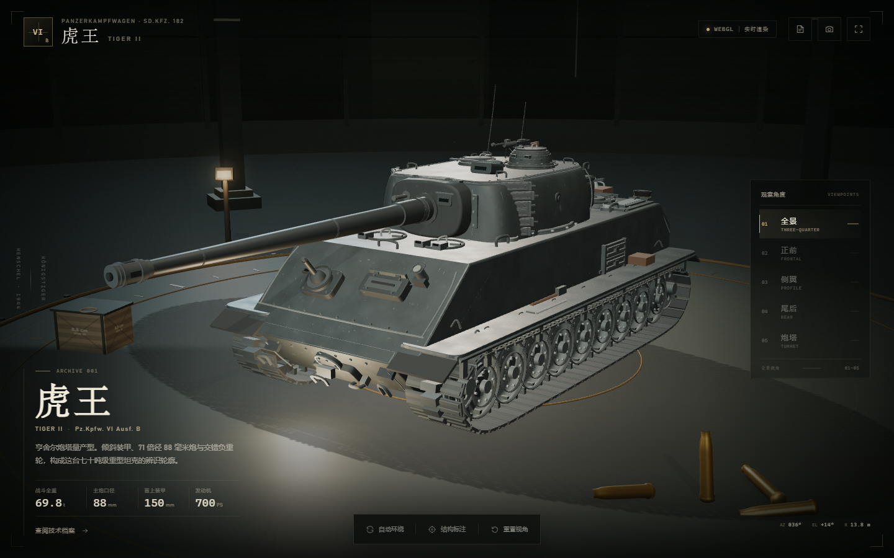
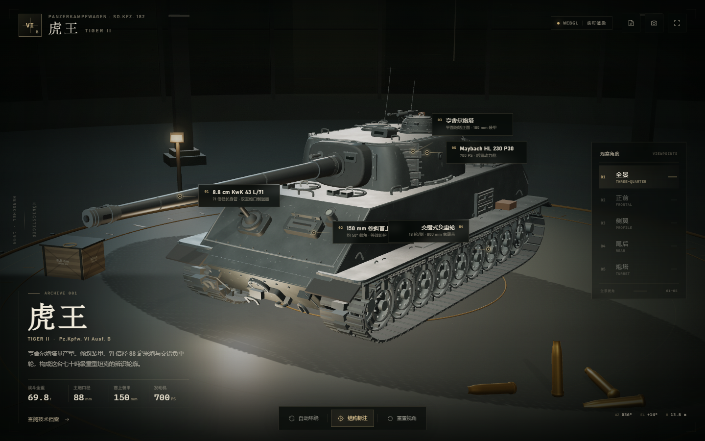
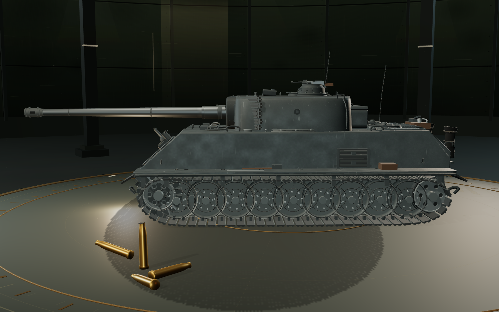
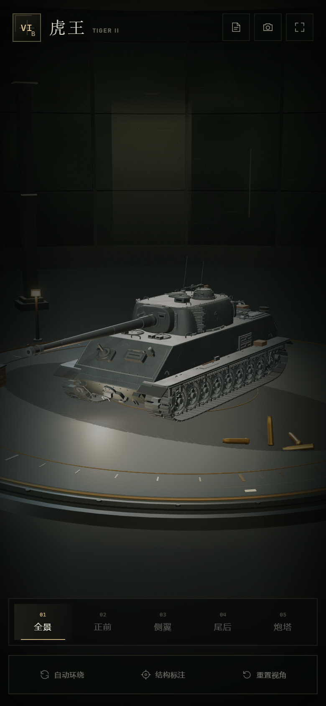
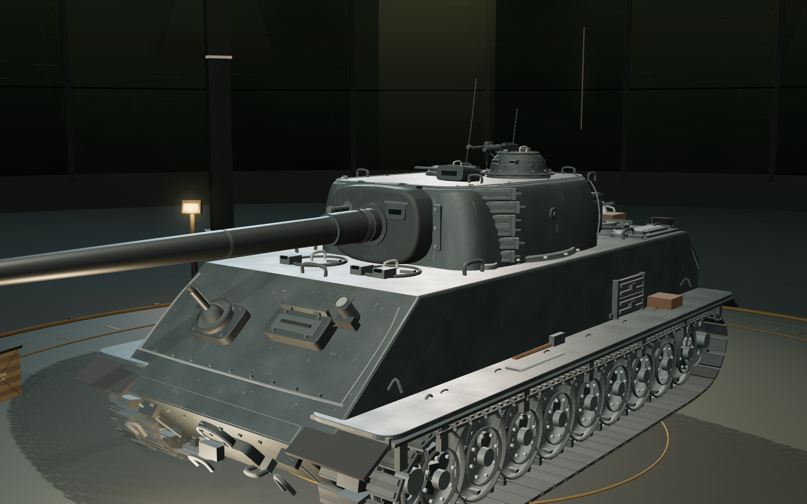

# 虎王 Tiger II · 三维装甲档案

> **这是德国二战重型坦克“虎王”**（Panzerkampfwagen VI Ausf. B / Tiger II / Königstiger），不是动物虎。
> 页面以程序化 Three.js 几何体复原亨舍尔车体与量产型炮塔，可自由环绕、缩放查看。

## 打开方式

双击 **`index.html`** 即可。整个页面（模型、贴图、灯光、界面和 Three.js）都内嵌在这一个文件里，**不需要联网，也不需要本地服务器**。

推荐使用最新版 Chrome、Edge、Firefox 或 Safari，并确保浏览器启用了 WebGL 2。

也可以双击 `打开虎王坦克.bat`，用系统默认浏览器打开。

## 预览











## 操作

| 操作 | 功能 |
| --- | --- |
| 鼠标左键拖拽 / 单指拖动 | 360° 环绕坦克 |
| 滚轮 / 双指捏合 | 缩放 |
| `1` — `5` | 全景 / 正前 / 侧翼 / 尾后 / 炮塔近景 |
| `R` | 重置为全景 |
| `A` | 开启 / 关闭自动环绕 |
| `N` | 显示 / 隐藏结构标注 |
| `I` | 打开技术档案 |
| `F` | 全屏 |
| `Esc` | 关闭技术档案 |

页面底部还提供“自动环绕”“结构标注”“重置视角”三个控制按钮，右上角可保存当前画面截图或进入全屏。

## 模型与场景

- **车体**：亨舍尔车体、倾斜首上装甲、驾驶员观察口、航向机枪球座、前后拖钩、前灯、带加强筋的挡泥板、车体随车工具与侧挂备用履带板。
- **炮塔**：量产型亨舍尔炮塔、重新放样并圆弧过渡的顶甲、明显内收的侧甲、锥形铸造炮盾、车长指挥塔、装填手舱盖、炮手瞄准镜、通风扇、右侧逃生舱门、炮塔后部储藏箱、前转角备用履带板与 AA 机枪。
- **火炮**：8.8 cm KwK 43 L/71，分段炮管、紧凑型双室炮口制退器、同轴机枪和炮盾。
- **行走机构**：9 轴 / 18 轮交错负重轮、碟形轮面与螺栓环、前置主动轮、后置诱导轮、逐节实例化的 800 mm 宽履带与履带销。
- **表面**：裸钢 / 深色金属 PBR；无迷彩、无战术编号、无国籍标志。炮塔铸造件、轧制装甲板、履带和炮管使用不同的粗糙度与金属度，并叠加轧制纹理、铸件粗糙面、使用划痕、焊缝和紧固件。
- **结构细节**：主要装甲接缝有实体焊缝，炮塔座圈、炮盾、翼子板和舱盖带有实体螺栓/铆钉；车体前部、发动机舱、排气管和尾部均有独立附件。
- **展陈环境**：暗色工业展厅、展示转台、刻度环、壁灯光带、灯柱、弹药箱、88 mm 弹壳和浮尘。
- **交互**：带阻尼的 OrbitControls 自由环绕、五个预设机位、自动环绕、结构热点、技术档案、截图和全屏。
- **适配**：桌面、平板和手机；竖屏会自动增大视场角并拉远距离，保证整辆坦克进入画面。

## 技术参数

| 项目 | 数据 |
| --- | --- |
| 正式编号 | Panzerkampfwagen VI Ausf. B (Sd.Kfz. 182) |
| 战斗全重 | 69.8 t |
| 车体长 / 含炮长 | 7.38 m / 10.29 m |
| 车宽 / 车高 | 3.76 m / 3.09 m |
| 乘员 | 5 人 |
| 发动机 | Maybach HL 230 P30，700 PS |
| 极速 | 41.5 km/h（公路） |
| 主炮 | 8.8 cm KwK 43 L/71 |
| 辅助武器 | 7.92 mm MG 34 × 2 |
| 车体首上 | 150 mm / 约 50° |
| 炮塔正面 | 180 mm |
| 侧装甲 | 80 mm |
| 负重轮 | 交错式，9 轴 / 18 轮每侧 |
| 服役时间 | 1944—1945 |

## 开发与重建

`index.html` 是已打包的最终单文件交付物。源代码在 `src/`：

```text
tiger-king-3d/
├─ index.html               单文件成品（直接打开）
├─ src/
│  ├─ index.template.html   HTML 模板
│  ├─ styles.css            界面样式
│  ├─ main.js               启动、相机、交互、结构标注
│  ├─ tank.js               坦克几何体、炮塔、行走机构、细节
│  ├─ environment.js        展厅、转台、灯光、粒子、道具
│  ├─ materials.js          裸钢/铸钢 PBR 着色器和金属材质
│  └─ textures.js           程序化 canvas 环境贴图与道具贴图
├─ vendor/                  Three.js r170 与 OrbitControls
├─ package.json             本地构建依赖与脚本
├─ build.mjs                esbuild 打包脚本
├─ previews/                预览图
└─ README.md
```

重建方式：

```bash
npm install
npm run build        # 生成 index.html
# npm run dev        # 开发构建，带内联 sourcemap
```

构建脚本会把 CSS、打包后的 JS 和 Three.js 全部内联进 `index.html`，因此最终页面仍然可以离线双击打开。

如果不想安装 npm 依赖，也可以把 `ESBUILD_BIN` 指向本机已有的 esbuild 可执行文件，再运行 `node build.mjs`。

## 说明与限制

- 本模型是**程序化艺术复原**，用于观察车辆外形和结构关系；装甲角度与附件配置作过视觉化取舍，**不是测绘级工程图**。
- 本版按用户要求采用**裸钢展示**：不含迷彩涂装、战术编号、Balkenkreuz 或任何政治性标志，不作为特定部队车辆的涂装复原。
- “虎王 / King Tiger / Königstiger”均指 Tiger II 重型坦克。
- 页面没有音效，不依赖外部字体、图片或 CDN。

## 第三方

- [Three.js](https://threejs.org/) r170 — MIT License
- OrbitControls — Three.js examples, MIT License

本页模型、着色器、程序化贴图和界面代码为本项目原创。
